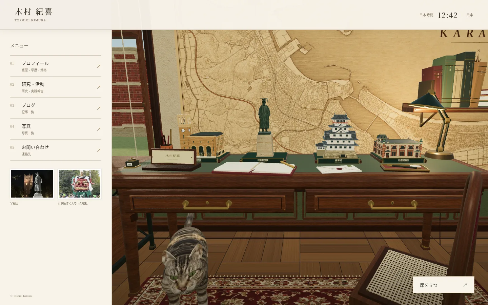
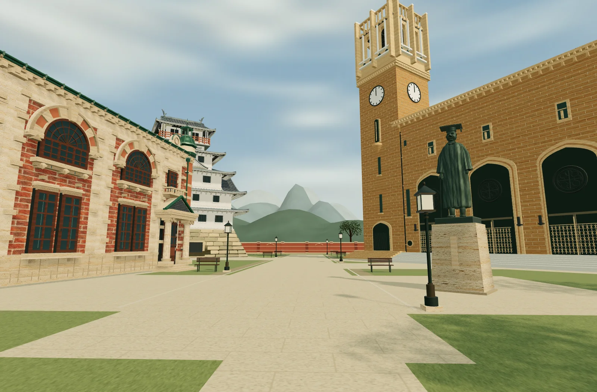
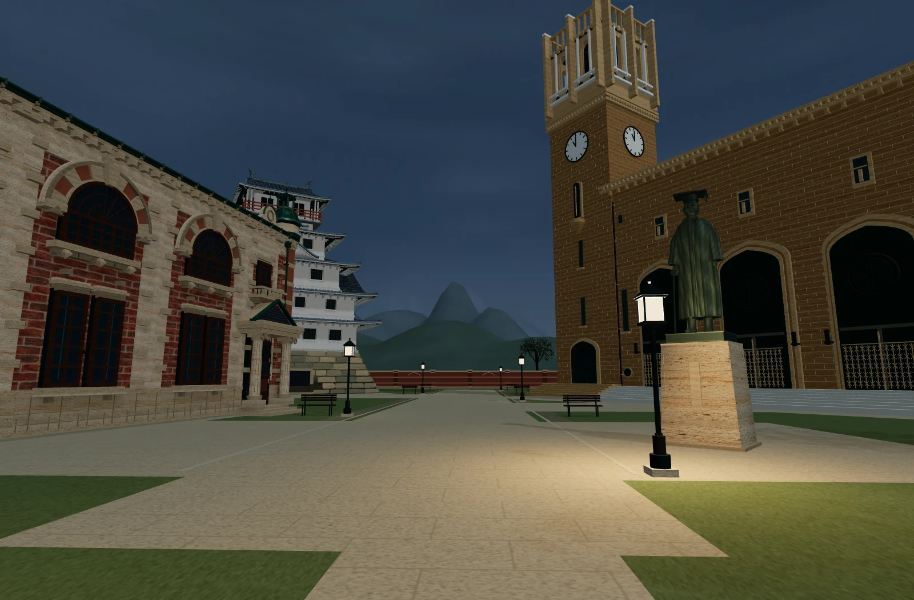

The homepage opens directly into the live 3D study. The five native page links remain available while the renderer loads. The introductory slogans have been removed; the name, menu labels, photographs and Japan-time clock remain.



Standing and sitting retain the same WebGL renderer, scene, decoded textures and cat. The first frame constructs the study, then starts the cat and desk miniatures independently. Garden terrain, courtyard walls and outdoor landmarks are prepared afterward. A temporary collision gate prevents walking into unloaded ground, and a failed garden load can be retried without losing the study.

The garden uses three grounded terrain layers, slope shading and a procedural atmosphere. The sky background is 512×256; its separate lighting texture is 256×128. Both change with Japan time and add no image downloads. The original cat, four desk miniatures, life-size monuments, warm room materials, photographs, redbrick enclosure and streetlamps remain.

Runtime work is reduced by caching the stationary furniture shadows, giving the moving cat a contact shadow, splitting foliage into spatial batches, limiting active nighttime point lights to the two nearest lamps, suspending offscreen rendering and reducing drawing resolution only after sustained slow frames. The terrain's subdivided ground and nonoverlapping paving retain the previous depth fixes. Walking consumes elapsed time in collision-safe steps; standing changes eye height over 0.9 seconds without importing or rebuilding the world.

Validation:

```sh
npm test
npm run build:world
# Start npm run dev -- --host 127.0.0.1 --port 4173, then:
npm run test:browser
node scripts/capture-live-world.mjs
```

The Chromium suite checks automatic live entry at 1440×900, 390×844 and 320×740, native menus before the engine download, absence of normal poster-image requests, Japan time, standing, sitting with the same context, walking through the physical doorway, and fallback access without WebGL or JavaScript. The runtime suite also covers delayed and failed loads, disposal races, offscreen pause/resume, cached shadows during cat animation, slow-frame movement, collisions and the original model geometry.

Screenshots and timing observations use Chromium with ANGLE SwiftShader, a software renderer. They demonstrate actual scene output and interaction, not real-device frame rates or network-loading promises. The browser evidence records native drawing-buffer sizes, request details and source hashes in [browser-report.json](reviews/live-study/browser-report.json).

All 17 automated suites passed. Compared with the previous 3D engine’s startup import graph, initial JavaScript fell from 235,099 to 214,947 gzip bytes (8.57%), with five initial files instead of seven. This compares engine startup, not the former static homepage, which deferred 3D until standing. Details are recorded in [performance.json](reviews/live-study/performance.json).

The actual-source capture uses the public stand/walk API and preserves the production eye position, FOV, geometry and clocks. [world-report.json](reviews/live-study/world-report.json) records all 52 source/asset/script hashes, native drawing-buffer sizes and Japan-time snapshots.




