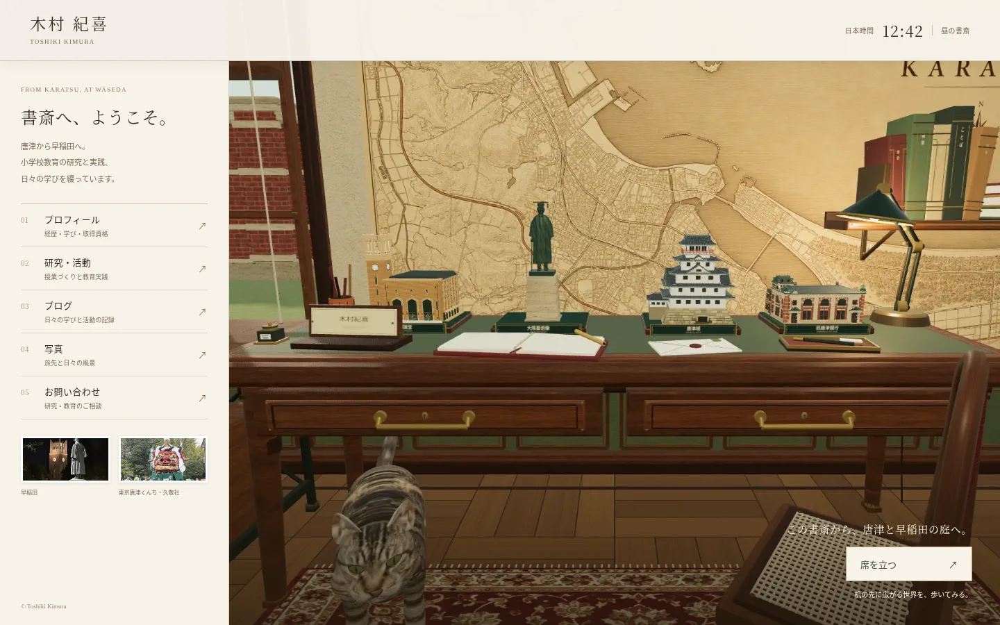
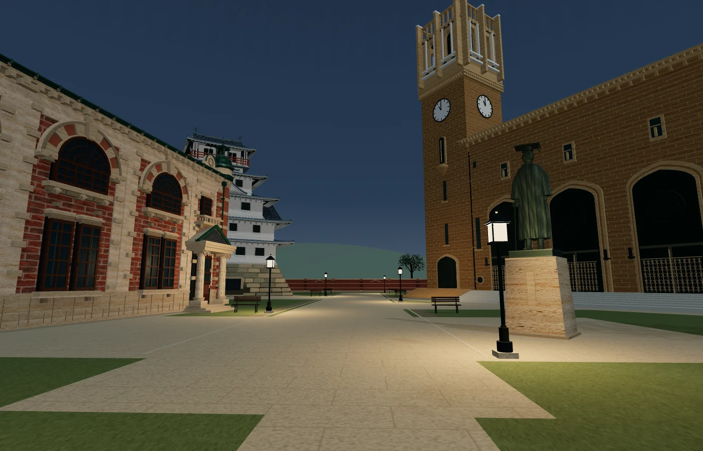

Historical record of PR #8. The later live-3D homepage replaces its static entry and renderer-remount behavior; see [the current implementation](live-study-20261107.md).

The homepage now opens as a seated view of the original study with five ordinary page links. The visitor can read the site immediately and choose **席を立つ** to load the walkable world. Sitting down again releases the renderer and restores the homepage.



- The warm plaster, sage, walnut, burgundy rug, original animated cat and four desk miniatures remain. The approved seated camera is `[0, 1.18, 1.65]`, looking at `[0, .86, 0]`; standing and sitting change eye height smoothly without moving the starting position.
- The homepage imports no Three.js modules, creates no WebGL context and downloads no 3D models before the visitor stands. Its two photographs reuse the existing owner-supplied Waseda and Tokyo Karatsu Kunchi / Kyukeisha images; their small derivatives total 27,720 bytes.
- The clock explicitly uses `Asia/Tokyo`. The wall clock and all four faces of both auditorium clocks, the sky, ambient light and lamps use the same actual date. Lighting previews retain the actual clock time. The still homepage selects day, dusk or night imagery; its frozen scene omits the wall clock and miniature clock hands, while the HTML clock remains current.
- The courtyard is enclosed by grounded redbrick walls with pale stone bands, pilasters, coping and shallow arch reliefs, inspired by Tatsuno Kingo’s architecture. Six warm streetlamps illuminate the paths; daylight-off lights are excluded from the active shader light list. Walls and lamp bases participate in walking collision checks. The original four outdoor landmarks remain life-size.
- Chromium inspection exposed an angle-dependent floor occlusion from the enormous ground quad. The terrain is subdivided so it cannot cover the parquet and rug when looking down.

The capture script renders the actual source scene in Chromium using ANGLE SwiftShader. It preserves scene geometry, materials and the approved camera; the frozen posters hide the wall clock and miniature clock hands so they do not contradict the live HTML clock. Outdoor captures restore every clock. Captures are evidence of rendering and composition, not a physical-device frame-rate benchmark.

Validation commands (start `npm run dev -- --host 127.0.0.1 --port 4173` for browser checks):

```sh
npm test
npm run build:world
npm run test:browser
node scripts/capture-seated-home.mjs --phase all --exterior
node scripts/prepare-home-photos.mjs
```

The browser check covers native menus before any WebGL request, desktop and narrow mobile layouts, the Japan-time clock, standing, walking through the doorway, night lighting, sitting, remounting, and graceful fallbacks with WebGL or JavaScript unavailable. Detailed source hashes and captures are recorded in [the capture manifest](reviews/seated-home/manifest.json) and [the browser report](reviews/seated-home/browser-report.json).

Final validation: all 17 `npm test` suites passed. Chromium checks passed at 1440×900, 390×844 and 320×740; each initial homepage made zero WebGL-context calls and zero world/model requests. The browser suite verified the native seat button, restored menus, renderer remount, doorway walk, lighting preview and the outdoor return button. The separate source capture completed the full physical walk back from the courtyard to the exact seated position.

The rendered sky patch changed from luminance 204.89 by day to 138.39 at dusk and 51.68 at night. This checks actual GPU output, including the environment cache invalidation.


